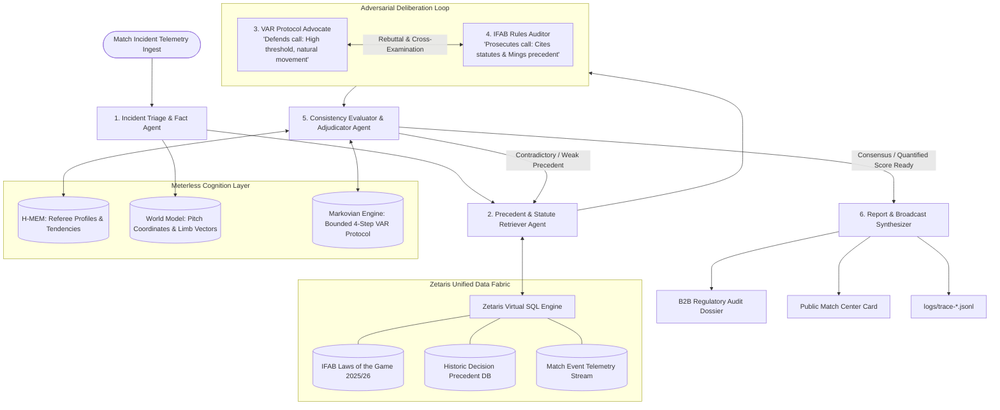

# Law18 — Multi-Agent Architecture & Specification (`AGENTS.md`)
**Open Agent Hackathon 2026 | Track 2: The Agent That Can Explain Why**

---

## 1. Multi-Agent System Philosophy

The core failure of traditional LLM sports analysis is that a single prompt tends to hallucinate opinions, adopt generic pundit speak, or rubber-stamp whatever decision was made on the pitch.

**Law18 replaces single-prompt guesswork with the "Cognitive Officiating Chamber"**: a structured, adversarial multi-agent system where no conclusion is accepted without rigorous challenge, strict IFAB statutory backing, historical precedent comparison, and referee psychological profiling.



---

## 2. Exhaustive Agent Specifications

### Agent 1: Incident Triage & Fact-Extraction Agent (`TriageAgent`)
* **Role**: The Chief Match Data Examiner.
* **Objective**: Ingests raw telemetry and structured match incident JSONs, validates physical facts, and routes the incident to the appropriate IFAB Law domain.
* **Input Schema**:
  ```json
  {
    "incident_id": "UCL-2026-LEG1-PUBILL-HANDBALL",
    "match": {
      "competition": "UEFA Champions League",
      "stage": "Quarter-Final Leg 1",
      "fixture": "FC Barcelona vs Atlético Madrid",
      "minute": 54,
      "referee": "István Kovács",
      "var_official": "Marco Di Bello"
    },
    "telemetry": {
      "incident_type": "HANDBALL",
      "player_involved": "Marc Pubill",
      "team": "Atlético Madrid",
      "ball_state": "LIVE_IN_PLAY",
      "prior_action": "GOAL_KICK_TAKEN_BY_MUSSO",
      "contact_point": "HAND_HOLDING_BALL",
      "on_field_decision": "NO_FOUL",
      "var_action": "NO_INTERVENTION"
    }
  }
  ```
* **Decision & Routing Tree**:
  * If `incident_type == "HANDBALL"` $\to$ Route to IFAB Law 12.1 (Handling the ball) and Law 16 (The Goal Kick).
  * If `incident_type == "SERIOUS_FOUL_PLAY"` or `"RECKLESS_CHALLENGE"` $\to$ Route to IFAB Law 12.3 (Disciplinary action, Careless vs Reckless vs Excessive Force).
  * If `incident_type == "DOGSO"` $\to$ Route to IFAB Law 12.3 (Denying an obvious goal-scoring opportunity: distance, direction, control, defenders).
* **Output**: Formatted `FactSheet` containing verified physical assertions, law routing keys, and spatial state passed to Meterless World Model.

---

### Agent 2: Precedent & Statute Retriever Agent (`RetrieverAgent`)
* **Role**: The Regulatory Research Officer.
* **Objective**: Interfaces directly with **Zetaris** to query the unified data fabric across codified IFAB rulebooks and the historical precedent database.
* **Zetaris SQL Queries**:
  ```sql
  -- Query 1: Extract exact IFAB statutory clauses
  SELECT law_id, sub_clause, text, guidance_note 
  FROM ifab_laws 
  WHERE law_id IN (12, 16) 
    AND (keywords LIKE '%goal kick%' OR keywords LIKE '%handball%');

  -- Query 2: Extract historical precedent matches
  SELECT match_date, competition, fixture, minute, incident_type, referee, ruling, outcome_penalized, uefa_post_review
  FROM season_precedents
  WHERE incident_type = 'HANDBALL_GOAL_KICK_PICKUP'
  ORDER BY similarity_vector DESC LIMIT 5;
  ```
* **Core Precedents Retrieved by Incident**:
  * **For Incident A (Pubill Handball)**:
    1. *Tyrone Mings (Club Brugge vs. Aston Villa, UCL Nov 6, 2024)*: Emi Martínez took short goal kick; Mings picked up live ball. Referee Tobias Stieler correctly awarded penalty kick. Similarity score: **0.98**.
    2. *Gabriel Magalhães (Arsenal vs. Bayern Munich, UCL April 9, 2024)*: Raya played goal kick; Gabriel picked it up. Ref Nyberg waved away as "kid's mistake", heavily criticized. Similarity score: **0.94**.
  * **For Incident B (Fermín High Boot)**:
    1. *Sadio Mané vs. Ederson (Man City vs. Liverpool, Sept 2017)*: Mané went for aerial ball with high boot catching Ederson in face. Straight red card for endangering player safety regardless of intent. Similarity score: **0.92**.
    2. *Jordan Pickford vs. Virgil van Dijk (Everton vs. Liverpool, Oct 2020)*: Goalkeeper lunging knee-high challenge. UEFA & PGMOL post-hoc admitted red card was mandatory. Similarity score: **0.89**.
  * **For Incident C (Eric García DOGSO)**:
    1. *David Luiz vs. Wolves (Arsenal vs. Wolves, Feb 2021)*: Accidental clipping of heels on counter-attack. Straight red given under double-jeopardy exclusion outside box. Similarity score: **0.91**.
* **Output**: Ranked precedent matrix with exact similarity vectors and IFAB statutory citation bundle.

---

### Agent 3: VAR Protocol Advocate Agent (`VARAdvocateAgent`)
* **Role**: The Officiating Defense Counsel.
* **Persona**: Experienced senior VAR official defending the on-field decision and the high threshold for VAR intervention.
* **Core Philosophy**: *"Football is a contact sport; VAR exists only for clear and obvious errors, not for re-refereeing subjective or optical illusions."*
* **Key Defense Strategies**:
  * **Clear and Obvious Barrier**: Argues that the on-field referee possessed a clear line of sight, and unless an objective factual error occurred, the VAR protocol strictly forbids intervention.
  * **Natural Biomechanical Movement**: Argues that arms/legs cannot be amputated; movements are natural consequences of running, jumping, landing, or protecting oneself.
  * **Lack of Malicious Intent / Accidental Collision**: Highlights that collisions are mutual, or that the opponent initiated or lowered themselves into the contact zone (e.g., claiming Fermín headed down toward Musso's clearance).
* **System Prompt Excerpt**:
  ```text
  You are the VAR Protocol Advocate. Your duty is to rigorously defend why the on-field referee and VAR team acted correctly under the official VAR protocol. You must emphasize the 'Clear and Obvious' standard, the referee's discretion, and physical biomechanics. Defend the decision with every legitimate technical justification available.
  ```

---

### Agent 4: IFAB Rules Auditor Agent (`RulesAuditorAgent`)
* **Role**: The Independent Regulatory Prosecutor.
* **Persona**: Meticulous compliance auditor and former elite FIFA referee instructor.
* **Core Philosophy**: *"Consistency is the bedrock of fairness. If Law 12 and Law 16 mandate a penalty in Bruges, they mandate a penalty at Camp Nou."*
* **Key Prosecution Strategies**:
  * **Strict Statute Application**: Dismantles vague "referee discretion" excuses by quoting the exact letter of IFAB laws (e.g., Law 16.1 states: *'The ball is in play when it is kicked and clearly moves'* — intent is legally irrelevant).
  * **Lethal Precedent Contrast**: Directly cross-examines the Advocate with contradictory rulings (e.g., *"Why was Tyrone Mings penalized in the exact same competition, but Marc Pubill was given immunity?"*).
  * **Endangerment of Safety**: Quotes Law 12.3 on Serious Foul Play: *'Any player who lunges at an opponent in challenging for the ball with excessive force or endangers the safety of an opponent must be sent off.'* Facial lacerations and emergency medical treatment cannot be excused as "natural momentum".
* **System Prompt Excerpt**:
  ```text
  You are the IFAB Rules Auditor. You represent the integrity of the game. Your duty is to challenge subjective officiating inconsistencies, cite exact IFAB statutory clauses, and confront the VAR Advocate with undeniable historical precedents. Expose where the officiating crew deviated from established standards.
  ```

---

### Agent 5: Consistency Evaluator & Adjudicator Agent (`EvaluatorAgent`)
* **Role**: The Chief Officiating Adjudicator.
* **Objective**: Listens to the adversarial exchange between `VARAdvocateAgent` and `RulesAuditorAgent`, accesses **Meterless H-MEM** for referee behavioral profiles, computes the **Quantitative Consistency Score**, and delivers the definitive verdict.
* **Meterless H-MEM Integration**:
  * Evaluates the specific tendencies of the match referee:
    * *István Kovács Profile*: Low foul intervention index (6.2 fouls/yellow), high threshold for penalty awards (0.18 penalties/game), known reluctance to utilize the pitchside monitor unless commanded by VAR.
    * *Clément Turpin Profile*: High red card index (0.34 reds/game), strict adherence to disciplinary protocols on DOGSO, prone to over-penalizing last-man contact.
* **Mathematical Consistency Score Formula**:
  $$\text{Consistency Score} = \left( w_1 \cdot S_{\text{precedent}} + w_2 \cdot S_{\text{statute}} - w_3 \cdot D_{\text{tolerance}} \right) \times 100$$
  * Where $w_1 = 0.50$ (Precedent alignment weight), $w_2 = 0.35$ (Clear statutory alignment), $w_3 = 0.15$ (Referee subjective variance delta).
* **Verdict Taxonomy**:
  * **Score 80–100%**: `CORRECT_CALL` (Standard application).
  * **Score 50–79%**: `MARGINAL_SUBJECTIVE` (Legitimate 50/50 grey zone; VAR protocol warrants standing with on-field call).
  * **Score 25–49%**: `UNWARRANTED_INTERVENTION` or `INCONSISTENT_DISCIPLINE` (Deviates significantly from standard precedent).
  * **Score 0–24%**: `CLEAR_AND_OBVIOUS_BLUNDER` (Gross error violating established law and precedent; failure of VAR).

---

### Agent 6: Report & Broadcast Synthesizer Agent (`SynthesizerAgent`)
* **Role**: The Communication Master.
* **Objective**: Powered by **NVIDIA Nemotron**, synthesizes the final outputs into two synchronized, high-impact formats:
  1. **B2B Regulatory Audit Dossier**: Full formal markdown report with executive summary, statutory clause citations, precedent matrix comparison, and official referee evaluation marks.
  2. **Public Match Center Card**: A 3-bullet, plain-English explainer crafted for stadium screens, television broadcast graphics, and social media.

---

## 3. LangGraph Execution State (`backend/app/graph/state.py`)

```python
from typing import TypedDict, List, Dict, Any, Optional

class Law18GraphState(TypedDict):
    # Ingestion & Context
    incident_id: str
    match_info: Dict[str, Any]
    telemetry: Dict[str, Any]
    
    # Retrieval Data
    ifab_citations: List[Dict[str, str]]
    precedents: List[Dict[str, Any]]
    referee_profile: Dict[str, Any]
    
    # Deliberation State
    advocate_arguments: List[str]
    auditor_arguments: List[str]
    rebuttal_turns: int
    deliberation_log: List[Dict[str, str]]
    
    # Adjudication & Scoring
    consistency_score: int
    verdict: str
    primary_failure_mode: Optional[str]
    
    # Dual Output Deliverables
    b2b_dossier_markdown: str
    public_card: Dict[str, Any]
    
    # Traceability
    trace_id: str
    execution_time_ms: float
```
