# Participant Journey Map

**OPEN AGENT HACKATHON 2026 | Build an Agent That Does Real Work**

This journey map shows the full participant path from registration to results. Use it to understand **what happens when**, **what you need to do**, and **what each milestone means for you or your team**.

All dates and deadlines are in **UTC**.

---

## 1. End-to-End Journey Visual

```mermaid
flowchart LR
    A[Registration<br/>Sign up on the event page<br/>Closes 22 Oct, 23:45] --> B[Sponsor Workshops<br/>Data Day 12 Oct, recording on HackOS<br/>Build Day and Power Day<br/>dates to follow]
    B --> C[HackOS Resources<br/>Sponsor folders, challenge pages,<br/>team formation]
    C --> D[21 Oct Participant Onboarding<br/>12:00 UTC: tracks, sponsor tech,<br/>HackOS walkthrough, Q&A]
    D --> E[22 - 27 Oct Build Window<br/>144 hours on HackOS]
    E --> F[27 Oct Submission Deadline<br/>Submit by 23:45 UTC]
    F --> G[28 Oct Judging<br/>Expert judges score<br/>against published criteria]
    G --> H[6 Nov Results<br/>Live results call on HackOS<br/>16:00 UTC]
    H --> I[Post-Event<br/>GenAI Works community on Discord]
```



---

## 2. Journey at a Glance

| Stage | Date / Window | What Happens | Your Primary Action | Outcome |
|---|---:|---|---|---|
| **1. Register** | **14 Aug – 22 Oct, 23:45** | Sign up through the event page. One sign-up covers the event, Discord, and community updates. | Register, log in to HackOS, and complete your profile. | You are registered for the hackathon. |
| **2. Sponsor Workshops** | **From 12 Oct** | Live workshops on GenAI Academy: Data Day (Zetaris) on 12 Oct, with Build Day and Power Day dates to be confirmed. Recordings are added to HackOS. | Attend live or watch the recordings. | You understand the sponsor technology. |
| **3. HackOS Resources** | **Before 22 Oct** | Sponsor folders in Resources, challenge pages, and team-finding are available on HackOS. | Review resources, shortlist your track, and decide whether to build solo or in a team. | You have a track shortlist and a plan for how you will build. |
| **4. Participant Onboarding** | **21 Oct, 12:00–13:30** | Official start of the participant experience, delivered by the GenAI Works team with technical walkthroughs from the Product Team. | Attend live, confirm your track, ask questions. | You are ready to build. |
| **5. Build Window** | **22 Oct, 00:00 – 27 Oct, 23:45** | 144-hour build period. Mentor office hours, the #help desk channel and the sponsor Help channels are live on HackOS. | Build, test, and prepare your submission materials. | Working solution ready for submission. |
| **6. Submission** | **27 Oct, 23:45** | Submit your project through HackOS. | Submit before the deadline. Do not rely on last-minute fixes. | Submission received. |
| **7. Judging** | **From 28 Oct** | Judging begins immediately after submissions close. Expert judges score submissions against the published criteria. | Monitor HackOS announcements. | Winners selected. |
| **8. Results** | **6 Nov, 16:00** | Winners announced on the live results call on HackOS. | Join the results call. | Prizes from a pool of up to $20,000. |
| **9. Post-Event** | **After 6 Nov** | Community activities continue on Discord. | Join the GenAI Works community on Discord. | Ongoing community connection. |

---

## 3. Stage-by-Stage Participant Path

---

## Stage 1 — Registration

**Goal:** Secure your place in the hackathon.

Registration is open through the event page: https://hackathon.genai.works/event/open-agent-hackathon-2026

| Item | Detail |
|---|---|
| **Opens** | 14 August 2026, 00:00 UTC |
| **Closes** | 22 October 2026, 23:45 UTC (hard deadline) |
| **Cost** | Free |
| **Eligibility** | Open worldwide to anyone aged 16 or older at the start of the build window |
| **Accounts** | One account per participant. Duplicate accounts disqualify the whole team. |
| **Prize eligibility** | Employees of the organizer and of judging sponsors may participate but are not eligible for cash prizes |

After registering, log in to HackOS and complete your profile:

- Your name and details
- Your technical skills
- Your preferred track, if requested
- If you plan to build alone, select **"happy to build solo"** in the registration form

### Participant Checklist

- [ ] Registered before 22 October, 23:45 UTC
- [ ] Logged in to HackOS
- [ ] Profile complete, including skills
- [ ] A realistic view of your availability between **22 and 27 October**

---

## Stage 2 — Sponsor Workshops

**Goal:** Learn the sponsor technology before the build starts.

Sponsors run live workshops covering their technology and how to use it in your build.

| Workshop | Sponsors and Focus | Date | Time |
|---|---|---|---|
| **Data Day** | Zetaris: serving internal data | 12 October 2026 | Recording on HackOS |
| **Build Day** | Cursor: build with. GenAI Works: how to build (vibe coding). Meterless engines: build faster | To be confirmed | To be confirmed |
| **Power Day** | NVIDIA: cloud provider. Meterless: local and cloud provider | To be confirmed | To be confirmed |

Join through the Open Agent Hackathon 2026 course on GenAI Academy: https://academy.genai.works/courses/open-agent-hackathon-2026/details

All workshops are recorded. Recordings and related resources are added to HackOS. If you cannot attend live, watch the recordings before the build window opens.

---

## Stage 3 — HackOS Resources and Team Formation

**Goal:** Prepare your track, team or solo plan, and environment before onboarding.

**HackOS** runs all hackathon operations. Use it to:

- Receive official announcements
- Access challenge pages and resources
- Watch sponsor workshop recordings
- Find teammates and create or manage your team
- Attend mentor office hours
- Ask technical questions in the #help desk channel, or sponsor questions in each sponsor's Help channel
- Submit your project
- Join the live results call

### Your First HackOS Actions

1. Find the announcements area
2. Locate Resources
3. Review:
   - Welcome Guide
   - Challenge pages
   - Event calendar
   - Sponsor folders in Resources (Zetaris, Meterless, Space XAI and Cursor, NVIDIA)
   - Sponsor workshop recordings
   - Submission requirements
4. Shortlist your track
5. Decide how you will build:
   - Solo, by selecting "happy to build solo" in the registration form
   - In a team you create on HackOS
   - In a team you join through team-finding on HackOS

Teams have 1–5 builders, and solo entries compete in the same pool as teams. A participant may belong to exactly one team. You can join, leave or merge teams freely until your first submission is created; team composition locks at that point.

---

## Stage 4 — 21 October Participant Onboarding

**Goal:** Start with the same context, rules, and technical expectations as every other participant.

Onboarding runs on **21 October, 12:00–13:30 UTC (5:00–6:30 AM PT)**. It is delivered by the GenAI Works team, with technical walkthroughs from the Product Team. If you can't attend live, the recording will be on HackOS.

### What Happens During Onboarding

| Segment | What It Covers |
|---|---|
| Welcome | Event purpose, timeline, expectations |
| Challenge tracks | The three tracks, the bonus track, and what strong solutions look like |
| Sponsor technology | How Zetaris, Meterless, Cursor, and NVIDIA fit into your build |
| HackOS walkthrough | Resources, teams, mentors, submission |
| Q&A | Open questions before the build starts |

### What You Should Decide by End of Onboarding

- [ ] Which track you are building for
- [ ] Whether you are building solo or in a team
- [ ] Which agent framework or architecture you intend to use
- [ ] Where Zetaris and Meterless fit in your build, and where NVIDIA can contribute
- [ ] What your first prototype milestone is
- [ ] Where to ask for help when blocked

---

## Stage 5 — 22–27 October Build Window

**Goal:** Build a working agent system for your chosen track.

The build window runs from **22 October, 00:00 UTC to 27 October, 23:45 UTC** (144 hours).

---

## 5.1 Challenge Tracks

Every submission selects exactly one primary track, which determines the judging panel and the prizes it competes for. You can change your track any time before the submission deadline from your team workspace.

| # | Track | What You Build |
|---:|---|---|
| 1 | **Solving Fragmented Intelligence** | Demonstrate a clever ability to discover and work across fragmented data sources. |
| 2 | **The Agent That Can Explain Why** | Build agents that investigate complex questions across multiple data sources, connect findings, and produce evidence-backed answers or recommendations. |
| 3 | **Reasoning Architecture** | Demonstrate a novel ability to turn data, knowledge, memory, and reasoning into reliable decisions and actions. |
| Bonus | **Wildcard [Tinkerer]: Bring Your Own Project** | Bring an existing project, prototype or concept and extend it using Zetaris and Meterless. Judged on the same criteria as the other tracks and scored on the new work rather than prior development. |

---

## 5.2 What Your Solution Must Demonstrate

| Requirement | What It Means |
|---|---|
| **Technical Execution** | The project must be functional and demonstrate a working implementation. |
| **Real-World Impact** | The project must address a clear, meaningful problem or user need. |
| **Innovation** | The submission should demonstrate a novel or creative approach to the problem. |
| **Demo Quality** | You must clearly demonstrate how the product works and its key functionality. |
| **Use of Technology** | The project must integrate Zetaris and Meterless, be developed using Cursor, and use NVIDIA technology wherever it contributes. |

---

## 5.3 What Counts as a Strong Agent System

### Weak

Avoid:

- Linear pipelines where Agent A → Agent B → Agent C with no interaction
- Agents acting as prompt wrappers
- No feedback loops
- No evidence of decision-making
- Nothing showing how the system reached its output

### Strong

Aim for:

- Agents delegating tasks dynamically
- Agents critiquing or validating outputs
- Planner ↔ Executor ↔ Evaluator loops
- Shared context or memory
- Branching, retries, escalation, and recovery
- Logs or traces showing how the system reasoned and refined its work

Example strong pattern:

```text
Planner creates approach
↓
Executor attempts task
↓
Evaluator detects missing evidence
↓
Planner revises plan
↓
Research Agent retrieves new context
↓
Executor reruns task
↓
Evaluator approves or requests another iteration
↓
Final Agent produces answer
```

---

## 5.4 Recommended Build Rhythm

| Date | Recommended Focus |
|---:|---|
| **22 Oct** | Confirm your track, user, and expected output. Connect Zetaris and Meterless. Build a basic working agent loop. |
| **23–24 Oct** | Add evaluation, critique, or review steps. Add retries, branching, and shared context or memory. Start logging agent activity. |
| **25 Oct** | Add datasets, tools, and retrieval. Test failures and fallbacks. |
| **26 Oct** | Complete your README, prepare your slide deck, test a clean setup from scratch, and record your demo video (1–4 minutes). |
| **27 Oct** | Final checks. Declare any pre-existing components. Submit early. Deadline is **23:45 UTC**. |

---

## Stage 6 — Submission

**Goal:** Submit a complete solution before the deadline.

> **27 October 2026, 23:45 UTC (hard deadline)**

## 6.1 Required Submission Components

Submit through HackOS.

| Component | Requirement |
|---|---|
| **Demo video** | 1–4 minutes, showing the main workflow, how the agent solves the selected challenge, its key features, and how Zetaris and Meterless are integrated |
| **Slide deck** | The problem and target users, the solution, the agent workflow or architecture, the technical stack, how Zetaris and Meterless were used, what was unique about your use of the sponsor technologies, product visuals, and future enhancements |
| **GitHub repository** | All source code and a README covering setup, usage and dependencies. If your agents run in Google Colab, include the Colab links |
| **Sponsor technology explanation** | How Zetaris and Meterless were integrated, how Cursor was used during development, where NVIDIA technology contributes, and what was unique about your use of the sponsor technologies |

Work committed before the build window opens is not eligible, except for clearly declared pre-existing components. Pre-existing product code must be declared in the submission form.

## 6.2 Final Pre-Submission Checklist

- [ ] Demo video (1–4 minutes) is uploaded
- [ ] Slide deck is complete
- [ ] GitHub repository link works and the README covers setup, usage and dependencies
- [ ] Sponsor technology explanation covers Zetaris, Meterless, Cursor and NVIDIA
- [ ] Any pre-existing components are declared
- [ ] No API keys or credentials are committed
- [ ] Submission is finalised before 23:45 UTC

---

## Stage 7 — Judging

**Goal:** Have your solution scored against the published criteria.

Judging opens on **28 October**, immediately after submissions close. Each submission is reviewed by at least three judges. The Wildcard [Tinkerer] track is scored on the new work rather than prior development.

| Criterion | Points |
|---|---:|
| Impact | 30 |
| Technical | 20 |
| Innovation | 15 |
| Demo | 15 |
| Product & UX | 10 |
| Sponsor Tech | 10 |
| **Total** | **100** |

Ties are resolved on the Impact score, then on submission timestamp. During judging, monitor announcements on HackOS.

---

## Stage 8 — Results and Post-Event

**Goal:** Find out the winners and stay connected.

| Item | Detail |
|---|---|
| **Results announced** | 6 November 2026, 16:00 UTC |
| **Where** | Live results call on HackOS |
| **Prize pool** | Up to $20,000: $15,000 in cash prizes and $5,000 in in-kind rewards for selected winners |
| **After the event** | Join the GenAI Works community on Discord for community chat and post-event activities |

---

## 4. Participant Decision Gates

| Gate | When | What Must Be True |
|---|---:|---|
| **Onboarding Gate** | 21 Oct | You have shortlisted your track and decided whether to build solo or in a team. |
| **Build Gate** | 22–27 Oct | You have a working agent system for your chosen track, integrating Zetaris and Meterless. |
| **Registration Gate** | 22 Oct, 23:45 | You are registered, aged 16 or older at the start of the build window, with one account. |
| **Submission Gate** | 27 Oct, 23:45 | All required submission components are submitted on HackOS. Your team locks when your first submission is created. |
| **Judging Gate** | From 28 Oct | Your solution scores well against the published criteria. |
| **Results** | 6 Nov, 16:00 | Winners are announced on the live results call. |

---

## 5. What to Do If You Get Stuck

All support during the hackathon happens on HackOS.

| Issue Type | Where to Go |
|---|---|
| Track scope and expectations | Challenge pages on HackOS |
| Sponsor technology setup and errors | Sponsor folder in Resources, then that sponsor's Help channel |
| Technical questions | #help desk channel on HackOS |
| Agent design, framework issues, debugging | Mentor office hours |
| Rules questions | hackathons@genai.works |
| Finding teammates | Team-finding |
| Official updates and milestone reminders | Announcements |

When asking for help, include what you are trying to do, your framework and stack, the error message, a relevant code snippet, and what you have already tried. Do not post API keys or secrets anywhere.

---

## 6. The Participant Success Pattern

```text
Register before 22 October, 23:45 UTC
→ Attend or watch the sponsor workshops
→ Review HackOS resources and decide: solo or team
→ Attend onboarding on 21 October
→ Choose a feasible track
→ Build a small working agent loop early
→ Integrate Zetaris and Meterless, and develop in Cursor
→ Log agent activity from day one
→ Improve the depth of your agent system
→ Record your demo and prepare your slide deck
→ Submit before 27 October, 23:45 UTC
→ Join the results call on 6 November
```

---

## 7. Final Reminder

| Focus On | Avoid |
|---|---|
| Working solutions | Slides and mockups |
| Agent systems | Linear prompt chains |
| Real problems | Novelty alone |
| Using the sponsor technology well | Rebuilding foundations |
| Clarity | UI polish only |
| Logs and traces | Invisible agent behaviour |

Your goal is to build a working agent system that solves a real problem and makes good use of the sponsor technology.

**Welcome to the Open Agent Hackathon 2026.**