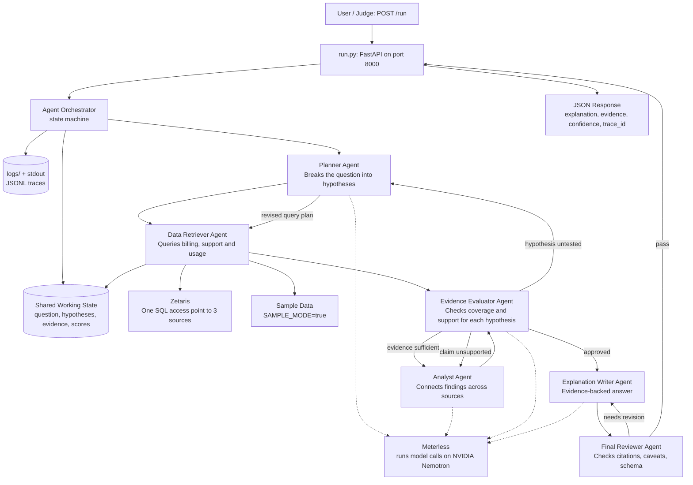
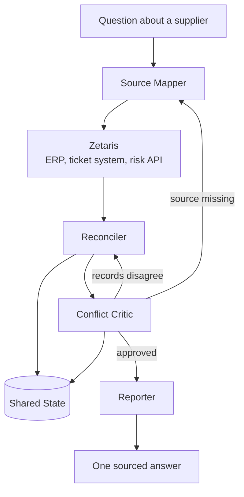
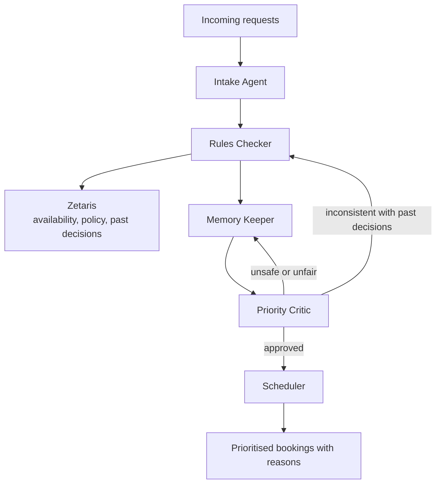

# Strong Submission Examples

**OPEN AGENT HACKATHON 2026 | Build an agent that does real work**

Use this resource as the **quality bar** for your submission. A strong submission is not a polished UI or a clever prompt. It is a working, reproducible agent system that shows **real collaboration**, integrates **Zetaris and Meterless** with a real role, and is easy for judges to run and understand.

The examples below are **illustrative composites**. They show what "strong" looks like for:

- Architecture diagrams
- Agent traces
- README documentation
- The sponsor technology explanation
- The slide deck and demo video
- Reproducible execution

> These are examples, not templates you must copy. Where anything here differs from the Official Rules on the event page, the Official Rules apply.

---

## 1. What Strong Looks Like at a Glance

| Criterion | Points | Strong Submission Evidence |
|---|---:|---|
| **Impact** | 30 | The README, deck and demo name a real user, a real problem and the track it answers. |
| **Technical** | 20 | Runs from a clean clone. Agents have distinct roles, real interdependence and traceable behaviour. Failures are handled. |
| **Innovation** | 15 | A thoughtful agent pattern, not a familiar chain with new labels. |
| **Demo** | 15 | 1–4 minutes. A real run, a collaboration moment in the logs, the output and why it matters. |
| **Product & UX** | 10 | The output is something the intended user could act on. |
| **Sponsor Tech** | 10 | Zetaris and Meterless are load-bearing, the project was built in Cursor, and NVIDIA contributes where it helps. |

---

## 2. Strong Architecture Example

### The example

**Track:** The Agent That Can Explain Why
**Project:** ChurnWhy
**User:** A customer success lead
**Goal:** Answer "why did churn rise this quarter?" with an evidence-backed explanation, drawing on billing, support and product usage data held in three separate systems.

### Why this architecture is strong

It is **not** a simple chain:

```text
Planner → Retriever → Summarizer → Writer
```

The agents share state, critique each other, retry when evidence is weak, and block claims the data does not support.

### Architecture diagram



### What a judge can see immediately

- Where agent decisions happen
- Where Zetaris and Meterless sit in the build
- How agents share state
- Where retries and feedback loops occur
- How failures fall back to sample data
- Where logs are written
- How the final answer is produced

---

## 3. Strong Collaboration Patterns

A strong system usually shows at least three of these:

| Pattern | Example |
|---|---|
| **Dynamic delegation** | Planner sends the Retriever back for usage data only if billing data doesn't explain the churn |
| **Critique loop** | Evaluator rejects an explanation that cites no support tickets |
| **Retry logic** | Retriever broadens a query after a source returns no rows |
| **Shared state** | Every agent reads and writes the same run state |
| **Escalation** | Retriever falls back to sample data if a source is unavailable |
| **Role authority** | Evaluator can block the Writer until every claim is supported |
| **Non-linear flow** | Agents branch on confidence, missing data or risk |

---

## 4. Strong Trace Example

Logs are the evidence that your agents did the work. Save them to `logs/` and print key events to stdout.

```jsonl
{"timestamp":"2026-10-24T10:15:31Z","trace_id":"run_churn_001","agent_name":"PlannerAgent","action":"decompose_question","input_summary":"Why did customer churn rise in Q3?","output_summary":"4 hypotheses: billing failures, support delays, feature adoption drop, price change","target_agent":"DataRetrieverAgent","confidence":0.88,"retry_count":0,"status":"success"}
{"timestamp":"2026-10-24T10:15:34Z","trace_id":"run_churn_001","agent_name":"DataRetrieverAgent","action":"query_zetaris","input_summary":"Billing and support tables for churned accounts, Q3","output_summary":"Retrieved 412 billing events and 1,108 tickets across 2 sources","target_agent":"EvidenceEvaluatorAgent","confidence":0.81,"retry_count":0,"status":"success"}
{"timestamp":"2026-10-24T10:15:36Z","trace_id":"run_churn_001","agent_name":"EvidenceEvaluatorAgent","action":"assess_coverage","input_summary":"Evidence for 4 hypotheses","output_summary":"Feature adoption hypothesis untested: no usage data retrieved. Requested revised plan.","target_agent":"PlannerAgent","confidence":0.62,"retry_count":0,"status":"needs_revision"}
{"timestamp":"2026-10-24T10:15:37Z","trace_id":"run_churn_001","agent_name":"PlannerAgent","action":"revise_plan","input_summary":"Evaluator flagged missing usage evidence","output_summary":"Added query for product usage events in the 30 days before churn","target_agent":"DataRetrieverAgent","confidence":0.86,"retry_count":1,"status":"success"}
{"timestamp":"2026-10-24T10:15:40Z","trace_id":"run_churn_001","agent_name":"DataRetrieverAgent","action":"query_zetaris","input_summary":"Product usage events, churned accounts","output_summary":"Usage source timed out after 20s. Retrying with a 30-day window only.","target_agent":"DataRetrieverAgent","confidence":0.55,"retry_count":1,"status":"retrying"}
{"timestamp":"2026-10-24T10:15:44Z","trace_id":"run_churn_001","agent_name":"DataRetrieverAgent","action":"query_zetaris","input_summary":"Narrowed usage query","output_summary":"Retrieved 9,840 usage events. All 3 sources now covered.","target_agent":"EvidenceEvaluatorAgent","confidence":0.82,"retry_count":1,"status":"success"}
{"timestamp":"2026-10-24T10:15:46Z","trace_id":"run_churn_001","agent_name":"EvidenceEvaluatorAgent","action":"assess_coverage","input_summary":"Evidence across billing, support and usage","output_summary":"Coverage sufficient for all 4 hypotheses","target_agent":"AnalystAgent","confidence":0.84,"retry_count":0,"status":"success"}
{"timestamp":"2026-10-24T10:15:51Z","trace_id":"run_churn_001","agent_name":"AnalystAgent","action":"connect_findings","input_summary":"Evidence from 3 sources","output_summary":"Churned accounts had 3x more failed payments and 2x slower ticket resolution. Price change also cited as a cause.","target_agent":"EvidenceEvaluatorAgent","confidence":0.77,"retry_count":0,"status":"needs_validation"}
{"timestamp":"2026-10-24T10:15:53Z","trace_id":"run_churn_001","agent_name":"EvidenceEvaluatorAgent","action":"validate_claims","input_summary":"3 findings and citation map","output_summary":"Rejected price-change claim: no pricing data was retrieved. Approved the other two findings.","target_agent":"AnalystAgent","confidence":0.90,"retry_count":0,"status":"partial_success"}
{"timestamp":"2026-10-24T10:15:55Z","trace_id":"run_churn_001","agent_name":"AnalystAgent","action":"revise_findings","input_summary":"Evaluator rejected unsupported price claim","output_summary":"Removed price claim. Listed pricing as an untested factor.","target_agent":"ExplanationWriterAgent","confidence":0.91,"retry_count":1,"status":"success"}
{"timestamp":"2026-10-24T10:16:00Z","trace_id":"run_churn_001","agent_name":"ExplanationWriterAgent","action":"draft_explanation","input_summary":"Validated findings and evidence map","output_summary":"Drafted explanation with evidence table, confidence and recommended actions","target_agent":"FinalReviewerAgent","confidence":0.86,"retry_count":0,"status":"success"}
{"timestamp":"2026-10-24T10:16:02Z","trace_id":"run_churn_001","agent_name":"FinalReviewerAgent","action":"review_output","input_summary":"Draft explanation","output_summary":"Missing caveat that findings show correlation, not proven causation. Requested revision.","target_agent":"ExplanationWriterAgent","confidence":0.83,"retry_count":0,"status":"needs_revision"}
{"timestamp":"2026-10-24T10:16:04Z","trace_id":"run_churn_001","agent_name":"ExplanationWriterAgent","action":"revise_explanation","input_summary":"Reviewer requested causation caveat","output_summary":"Added limitations section. Final explanation ready.","target_agent":"FinalReviewerAgent","confidence":0.94,"retry_count":1,"status":"success"}
{"timestamp":"2026-10-24T10:16:05Z","trace_id":"run_churn_001","agent_name":"FinalReviewerAgent","action":"approve_final","input_summary":"Revised explanation","output_summary":"Approved. Response includes explanation, evidence, confidence, limitations and trace_id.","target_agent":"APIResponse","confidence":0.93,"retry_count":0,"status":"success"}
```

### Why this trace is strong

- Agents interact more than once, in both directions
- The Evaluator stops the work when a hypothesis is untested
- The Planner revises its plan in response
- A Zetaris query fails, retries and recovers
- An unsupported claim is caught and removed
- A final review adds an honest caveat
- Every step carries a `trace_id`, confidence and retry count

---

## 5. Strong Sponsor Technology Explanation

Sponsor Tech is worth 10 points. A strong explanation is specific about what each technology does in the build.

```markdown
## Sponsor Technology

**Zetaris (data).** Billing, support and product usage live in three separate systems.
We registered all three in Zetaris and query them through its REST API with SQL, so the
Data Retriever asks one access point instead of maintaining three connectors. Every
explanation the agent produces traces back to rows retrieved through Zetaris.

**Meterless (model runtime).** All model calls from the Planner, Analyst, Evaluator and
Writer run through Meterless, which gives us one configuration for local development
and cloud runs.

**NVIDIA (models).** The agents reason with NVIDIA Nemotron, reached through Meterless.
We use a larger Nemotron model for the Analyst and Evaluator and a smaller one for
query planning.

**Cursor (development).** The project was built in Cursor. We used its Agent chat to
scaffold the repository, write the Zetaris adapter and generate tests, and reviewed
every change before committing.

**What was unique.** The Evaluator uses Zetaris directly to check claims: before any
finding is approved, it runs its own query to confirm the numbers the Analyst cited.
```

---

## 6. Strong README Example

A strong README is complete, specific and practical, not long for the sake of it.

---

### README: ChurnWhy

> **Track:** The Agent That Can Explain Why
> **Sponsor technology:** Zetaris, Meterless, NVIDIA Nemotron, built in Cursor
> **Run:** `python run.py`, then `POST /run` on port 8000

#### 1. Problem

Customer success leads see churn rise but can't say why. The answer is spread across billing, support and product usage systems that don't talk to each other, and pulling it together by hand takes days.

ChurnWhy answers "why did churn rise?" with an evidence-backed explanation that shows where every finding came from.

#### 2. Agents

| Agent | Responsibility | Can block or retry? |
|---|---|---|
| `PlannerAgent` | Turns the question into testable hypotheses; revises the plan | Yes |
| `DataRetrieverAgent` | Queries the three sources through Zetaris | Yes |
| `EvidenceEvaluatorAgent` | Checks coverage and whether each claim is supported | Yes |
| `AnalystAgent` | Connects findings across sources | Yes |
| `ExplanationWriterAgent` | Writes the evidence-backed explanation | No |
| `FinalReviewerAgent` | Checks caveats, citations and schema | Yes |

#### 3. What makes this an agent system

- Planner ↔ Evaluator loop for untested hypotheses
- Retriever retry and fallback when a source fails
- Evaluator blocks unsupported claims
- Final Reviewer ↔ Writer revision loop
- Shared state across all agents
- Structured traces for every decision

#### 4. Tech stack

| Component | Technology |
|---|---|
| API | FastAPI |
| Orchestration | State machine |
| Data access | Zetaris REST API |
| Model runtime | Meterless |
| Models | NVIDIA Nemotron |
| Development | Cursor |
| Logging | JSONL in `logs/` and stdout |
| Container | Docker |

#### 5. Setup

```bash
cp .env.example .env     # fill in your keys; never commit .env
python -m venv .venv
source .venv/bin/activate
pip install -r requirements.txt
python run.py
```

Or with Docker:

```bash
docker build -t churnwhy .
docker run --rm -p 8000:8000 --env-file .env churnwhy
```

#### 6. Usage

```bash
curl -X POST http://localhost:8000/run \
  -H "Content-Type: application/json" \
  -d @input_examples/example_1.json
```

**Request:**

```json
{
  "question": "Why did customer churn rise in Q3?",
  "period": "2026-Q3",
  "segment": "SMB"
}
```

**Response (abridged):**

```json
{
  "trace_id": "run_churn_001",
  "explanation": {
    "summary": "Churned SMB accounts in Q3 had three times more failed payments and twice the ticket resolution time of retained accounts.",
    "findings": [
      {
        "finding": "Failed payments rose sharply among accounts that churned.",
        "confidence": "high",
        "evidence": ["billing.payment_events", "412 events"]
      },
      {
        "finding": "Support tickets from churned accounts took twice as long to resolve.",
        "confidence": "medium",
        "evidence": ["support.tickets", "1,108 tickets"]
      }
    ],
    "untested_factors": ["Pricing: no pricing data was available"],
    "limitations": ["Findings show correlation, not proven causation."],
    "recommended_actions": [
      "Add automated payment retry and card-update reminders for SMB accounts.",
      "Set a resolution-time target for tickets from at-risk accounts."
    ]
  },
  "confidence": 0.86
}
```

#### 7. Sample mode

`SAMPLE_MODE=true` runs the full agent loop on synthetic sample data in `data/`, with no live credentials. Agents still reason over the data; no final answers are stored.

#### 8. Failure handling

| Failure | Behaviour |
|---|---|
| Zetaris source timeout | Retries with a narrower query, then falls back to sample data |
| Empty result | Planner broadens the hypothesis |
| Unsupported claim | Evaluator blocks it and requests revision |
| Model call failure | Retries once, then returns a structured error |
| Malformed input | Returns `400` with a validation message |

#### 9. Data and licensing

All demo data is synthetic and labelled as such. No real customer data is used. See `data/README.md`.

#### 10. Limitations

- Findings show correlation, not proven causation
- Explanations depend on which sources are registered in Zetaris
- English-language questions only

#### 11. Pre-existing components

None. All code was written during the build window.

---

## 7. Strong Slide Deck Outline

| Slide | Content |
|---|---|
| 1 | **Problem and users:** customer success leads can't explain churn from scattered data |
| 2 | **The solution:** ChurnWhy, an agent that explains churn with evidence |
| 3 | **Agent workflow:** the architecture diagram and the feedback loops |
| 4 | **Technical stack:** FastAPI, state machine, Zetaris, Meterless, Nemotron, Cursor |
| 5 | **How Zetaris and Meterless were used:** one access point to three sources; one runtime for every model call |
| 6 | **What was unique:** the Evaluator verifies claims against Zetaris before approving them |
| 7 | **Product visuals:** the explanation, evidence table and confidence |
| 8 | **Future enhancements:** more sources, scheduled monitoring, alerts for at-risk accounts |

---

## 8. Strong Demo Video

Your demo must be **1–4 minutes** and must prove the system works, not just describe the idea.

### Structure (3 minutes 30 seconds)

| Time | Segment | What to Show |
|---:|---|---|
| 0:00–0:20 | **Problem** | The user, the track and why it matters |
| 0:20–0:50 | **Architecture** | The diagram and the feedback loops |
| 0:50–1:40 | **Live run** | A real request and the agent working |
| 1:40–2:20 | **Collaboration** | The trace: an untested hypothesis, a retry, a blocked claim |
| 2:20–2:50 | **Sponsor technology** | Zetaris queries and Meterless model calls in action |
| 2:50–3:30 | **Output and impact** | The explanation and what the user can do with it |

### Script

**0:00–0:20 — Problem**

> "Customer success leads can see churn rising but can't say why, because the answer is split across billing, support and usage systems. ChurnWhy is our entry for The Agent That Can Explain Why. It answers that question with evidence."

**0:20–0:50 — Architecture**

> "Six agents work together. The key is that it isn't a chain: the Evidence Evaluator can send the Planner back when a hypothesis hasn't been tested, and it blocks any claim the data doesn't support."

**0:50–1:40 — Live run**

> "Here's a real request: why did churn rise in Q3 for SMB accounts? The Retriever queries all three sources through Zetaris."

```bash
curl -X POST http://localhost:8000/run \
  -H "Content-Type: application/json" \
  -d @input_examples/example_1.json
```

**1:40–2:20 — Collaboration**

> "In the trace, the Evaluator flagged that we hadn't tested feature adoption, so the Planner added a usage query. That source timed out, the Retriever narrowed the query and recovered. Then the Analyst blamed a price change, but there was no pricing data, so the Evaluator rejected that claim."

**2:20–2:50 — Sponsor technology**

> "Zetaris gives the agent one SQL access point to all three systems. Every model call runs on NVIDIA Nemotron through Meterless. And we built the whole thing in Cursor."

**2:50–3:30 — Output and impact**

> "The result: failed payments and slow ticket resolution explain most of the rise, with the evidence for each, an honest caveat, and two actions the team can take this week."

### Recording checklist

- [ ] 1–4 minutes
- [ ] Names the track and the user
- [ ] Shows the agent architecture
- [ ] Shows a real run
- [ ] Shows at least one collaboration moment in the logs
- [ ] Shows Zetaris and Meterless in action
- [ ] Shows the final output and why it is useful
- [ ] No API keys, credentials or sensitive data on screen

---

## 9. Strong Architectures by Track

### Solving Fragmented Intelligence

**Project:** SupplyLens — answers supplier questions across systems that disagree.



Strong signals: the Conflict Critic sends disagreements back to the Reconciler; the Source Mapper adds a source when coverage is missing; every fact in the answer names its source.

---

### Reasoning Architecture

**Project:** TriageDesk — decides how to handle incoming clinic appointment requests.



Strong signals: memory of past decisions changes the current one; the Priority Critic can block a decision; every booking carries its reasoning.

---

### Wildcard [Tinkerer]

**Project:** An existing document-search prototype, extended during the hackathon.

```text
Before 22 October (declared):
  Keyword search over a document set

Built during the hackathon:
  + Zetaris connects the documents to two structured databases
  + Meterless runs the new reasoning agents
  + Evaluator agent checks answers against both sources
```

Strong signals: a clear, declared before and after; the new capability depends on Zetaris and Meterless; the demo shows the difference.

---

## 10. Strong Repository Structure

```text
/project-root
│── app/
│   │── config.py
│   │── schemas.py
│   │── agents/
│   │   │── planner.py
│   │   │── retriever.py
│   │   │── evaluator.py
│   │   │── analyst.py
│   │   │── writer.py
│   │   └── reviewer.py
│   │── orchestration/
│   │   │── graph.py
│   │   └── state.py
│   │── adapters/
│   │   │── zetaris.py
│   │   │── meterless.py
│   │   └── sample_data.py
│   └── tracing.py
│── data/
│   │── README.md
│   └── sample/
│── scripts/
│── input_examples/
│   │── example_1.json
│   │── example_2.json
│   └── example_3.json
│── output_examples/
│   │── example_1_output.json
│   │── example_2_output.json
│   └── example_3_output.json
│── logs/
│── run.py
│── requirements.txt
│── Dockerfile
│── .env.example
└── README.md
```

---

## 11. Strong `.env.example`

```bash
# Model runtime
MODEL_API_KEY=your-meterless-or-provider-key-here
MODEL_BASE_URL=https://your-provider-address.example/v1
MODEL_REASONING=your-larger-model-id
MODEL_FAST=your-smaller-model-id

# Zetaris
ZETARIS_REST_URL=http://localhost:8888/api/v1.0
ZETARIS_ORG_ID=1
ZETARIS_API_KEY=your-zetaris-api-key-here

# Runtime
SAMPLE_MODE=true
LOG_LEVEL=INFO
SOURCE_TIMEOUT_SECONDS=20
MAX_RETRIES=2
```

Strong because it has no real keys, names every variable the project needs, supports sample mode and makes runs predictable.

---

## 12. Strong Input Examples

**`input_examples/example_1.json`**

```json
{ "question": "Why did customer churn rise in Q3?", "period": "2026-Q3", "segment": "SMB" }
```

**`input_examples/example_2.json`**

```json
{ "question": "Which accounts are most at risk of churning next month, and why?", "period": "2026-10", "segment": "all" }
```

**`input_examples/example_3.json`**

```json
{ "question": "Did the new onboarding flow reduce early churn?", "period": "2026-Q3", "segment": "new_accounts" }
```

Output examples are real outputs saved after successful runs, never returned at runtime.

---

## 13. Collaboration Evidence Checklist

Inspect your own logs and ask:

- [ ] Do at least two agents interact more than once?
- [ ] Does one agent critique or validate another's output?
- [ ] Is there a retry, branch, fallback or escalation?
- [ ] Is there shared state across agents?
- [ ] Can an evaluator or reviewer block poor output?
- [ ] Are Zetaris and Meterless calls visible?
- [ ] Are agent roles clearly distinct?
- [ ] Are traces saved to `logs/` and visible in stdout?
- [ ] Would a judge understand the workflow from the logs alone?

If most answers are "no", your submission probably reads as a pipeline.

---

## 14. Strong vs Weak

| Weak | Strong |
|---|---|
| "We have three agents: A, B and C." | Agents have clear roles, authority and interaction rules |
| A passes to B, B passes to C | Agents loop, critique, retry, branch and revise |
| Zetaris named in the README only | Zetaris is the agent's access point to the data |
| Logs say "Agent started" and "Agent finished" | Logs show decisions, targets, confidence, retries and status |
| README says "run the app" | README has exact commands, examples and limitations |
| Demo shows only UI screens | Demo shows a real run, the trace and the output |
| Hardcoded sample answers | Real logic, with sample mode for inputs only |
| No error handling | Timeouts, retries, fallbacks and structured errors |

---

## 15. Pre-Flight Check

### Submission components

- [ ] Public GitHub repository with a README covering setup, usage and dependencies
- [ ] Demo video, 1–4 minutes
- [ ] Slide deck covering all eight points
- [ ] Sponsor technology explanation
- [ ] Pre-existing components declared

### Behaviour

- [ ] Runs from a clean clone with documented commands
- [ ] Zetaris and Meterless integrated with a real role
- [ ] Built in Cursor; NVIDIA used where it contributes
- [ ] No committed keys
- [ ] Runs in minutes, without a local GPU
- [ ] Handles failures gracefully
- [ ] Produces structured logs
- [ ] Shows real agent collaboration

### Recommended extras

- [ ] Architecture diagram in the README
- [ ] Sample mode
- [ ] At least three input and output examples
- [ ] A clear limitations section

---

## 16. What Judges Should Be Able to Say

After reviewing a strong submission, judges should be able to say:

> "I understand the problem this solves and who it's for."

> "It clearly answers the track it was submitted to."

> "I can run it without manual setup."

> "Zetaris and Meterless do real work in this build."

> "The agents have distinct responsibilities."

> "The logs prove real collaboration, not a linear chain."

> "The output is something the user could act on."

> "The team made thoughtful trade-offs and was honest about limits."

That is the bar.